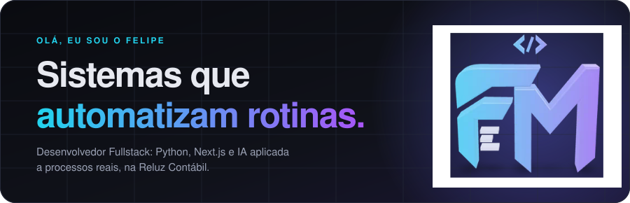
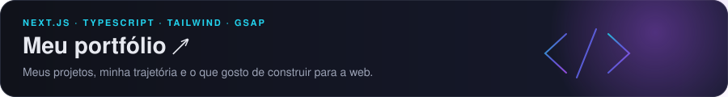
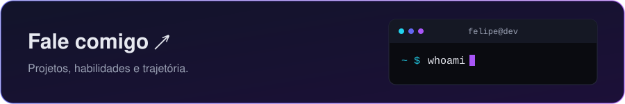

  

## Projetos para explorar

<table>
  <tr>
    <td width="33%" valign="top">
      <a href="https://devfelipemartins.com.br/#projetos"><b>Gestão de Frotas ↗</b></a> 
      Robôs que consultam ANTT, ARTESP, EMTU e SPTrans e alertam sobre vencimentos.
    </td>
    <td width="33%" valign="top">
      <a href="https://devfelipemartins.com.br/#projetos"><b>Gestão de Apólices ↗</b></a> 
      Lê PDFs de várias seguradoras e entrega dashboard com alertas de renovação.
    </td>
    <td width="33%" valign="top">
      <a href="https://devfelipemartins.com.br/#projetos"><b>Consulta Domínio ↗</b></a> 
      Painéis de horas por empresa e colaborador a partir do banco do ERP.
    </td>
  </tr>
</table>

## Ferramentas do meu dia a dia

  
  
  
  
  
  
  
  
  
  
  

---

📍 Ribeirão Pires, SP · 🎓 ADS na USCS · 📫 <a href="mailto:dev.felipemartins@gmail.com">dev.felipemartins@gmail.com</a> · <a href="https://www.linkedin.com/in/felipe-martins-686887266/">LinkedIn</a>
